# SO-101 + SmolVLA：仿真抓放与 PPO 残差

在 MuJoCo 中复现 SO-101 的语言条件抓放：脚本专家采集 LeRobot 数据，两段式微调 SmolVLA，再用 PPO 残差修正末端；固定 20 个 seed 的抓取成功率从 21% 提到 63%，非默认颜色指令从 31% 提到 82%，PPO 残差在 60 个训练外 seed 上从 20.0% 提到 34.5%、抬升高度 +13%。

## 项目简介

项目目标是验证一条完整的仿真具身流水线：脚本专家 → 语言条件数据集 → VLA 微调 → 强化学习残差 → 固定 seed 闭环评测。

仓库包含两套环境：

| 管线 | 场景 | 观测/动作 | 用途 |
|---|---|---|---|
| 本地单任务 | `sim_scene.xml` 平桌面，红方块 + 绿目标 | 512×512 双相机；6 舵机 0–180° | 冒烟、脚本采集、遥操作、闭环评测 |
| 主链路 | `so101_nexus` 的 `MuJoCoPickLift-v1`，三色 25 mm 方块（目标 + 2 个干扰物） | 640×480 overhead + wrist；前 5 关节度、夹爪 0–100% | 反事实/换色/retry 数据、SmolVLA 训练、PPO 残差 |

两套管线的数据口径不同，不要混用。

## 核心结果

| 指标 | 基线 | 本方案 | 评测设置 |
|---|---:|---:|---|
| 抓取成功率 | 21% | 63% | 固定 20 个 seed，闭环 |
| 非默认颜色指令成功率 | 31% | 82% | 固定 20 个 seed，闭环 |
| PPO 残差抓取成功率 | 20.0% | 34.5% | 60 个训练外 seed |
| PPO 残差抬升高度 | — | +13% | 相对零残差基线 |

前两行是两段式微调前/后的对比；后两行是冻结基座上的零残差基线与 PPO 残差策略的对比。评测 seed 从 10000 起，与训练 seed 不重叠；残差评测不加探索噪声，取策略均值。

| 项目 | 数值 | 说明 |
|---|---:|---|
| 无人值守连续采集 | 约 190 条 / 6 小时 | 单轮长时程采集 |
| 累计训练数据 | 1222 条 / 185502 帧 | colors + colors_retry |
| 两段式微调可训练参数 | 0.999 亿 → 3.93 亿 | 冻结 VLM → 全量解冻 |

## 方法/流水线

```
脚本专家 / 反事实换色 / 抓空重抓
        │  LeRobot v3：parquet + mp4
        ▼
lerobot/smolvla_base
        │  S1–S3：只训专家（0.999 亿）
        │  S4：colors 只训专家
        │  S5–S6：全量解冻（3.93 亿）
        ▼
best checkpoint（013408）
        │  冻结
        ▼
PPO 残差（32 维观测 → 6 维增量）→ 固定 seed 闭环评测
```

### 1. 场景与专家

主链路用 `so101_nexus` 的 `MuJoCoPickLift-v1`：`PickConfig(obs_mode="visual", ...)`，场上 3 个 25 mm 方块，目标从红/绿/蓝中随机指定，另外 2 个作为干扰物；两路相机为 `overhead` 和 `wrist`，640×480，30 fps。采集用 `pd_ee_delta_pose`，评测用 `pd_joint_pos`。

`_ref/collect_lerobot.py` 的脚本专家分四段：悬停 → 下降 → 合爪 60 步 → 抬起。动作记的是命令下去的关节目标角（`data.ctrl`），不是当前关节角，保证 `obs[t] → action[t] → obs[t+1]` 的配对。

本地单任务管线用 `sim_env.py` + `expert.py`：`mink` 做 IK，`run_episode` 包含 home、above_pick、at_pick、closed、lifted、above_place、at_place、released、settled 等阶段；全程关闭 weld，用纯物理抓取。

### 2. 数据

反事实数据：208 个 seed × 3 个颜色，同一 seed 的三条轨迹共享同一份物体摆位，只有指令里的颜色词不同。实际成功 615/624 条，写成 `so101_picklift_cf`。

换色数据：104 个布局 × 2 套配色（`rgb` / `gbr`，循环左移）× 3 个钉住目标，共 624 次设计，实收 618 条 `so101_picklift_colors`。同一 `(seed, k)` 下两套配色的目标位置逐位相同，只有颜色词不同。

抓空重抓：`RETRY=1` 时专家先朝偏移位置抓一次空的、张开、再抓真的。`rgb` 数据里 45 条（`RETRY_PROB=0.15`），`colors_retry` 里 230 条（`RETRY_PROB=0.5`）。这是整套数据里唯一带「抓空 → 张开 → 重抓」的样本。

只保留成功 episode；失败条目用 `clear_episode_buffer()` 丢弃。无人值守单轮 6 小时约 190 条，`colors` + `colors_retry` 累计 1222 条 / 185502 帧。

### 3. SmolVLA 两段式微调

起点是官方 `lerobot/smolvla_base`。第一段冻结 VLM，只训动作专家，`num_learnable_params=99,880,992`；第二段同时打开 `train_expert_only=false` 和 `freeze_vision_encoder=false`，全量解冻，`num_learnable_params=392,904,096`。

两个开关必须一起给：在 `smolvlm_with_expert.py` 的 `set_requires_grad` 里，`train_expert_only` 分支排在 `freeze_vision_encoder` 判断之后，只改后者不会解冻视觉塔。启动后先看日志里的 `num_learnable_params`，再决定是否继续。

完整链路：

```
lerobot/smolvla_base
  → cf_retry_expert/020000 → /100000 → /200000
  → colors_expert/024500
  → colors_unfrozen/014670（取 3 epoch 那档）
  → colors_retry_unfrozen/013408（best）
```

### 4. PPO 残差

基座 SmolVLA 冻结、不出梯度；残差网络读 32 维观测，每步输出 6 维增量：5 个臂关节各 ±2°，夹爪 0.15 rad。残差在合爪后 60 步内生效，抬升和放置仍由基座策略执行。

奖励由 grasping、task_objective、completion_bonus、势能差分和残差惩罚组成；PPO 用 stable-baselines3，`VecNormalize` 保存观测统计量，评测时使用确定性均值和同一份统计量。

`train_residual_ppo.py` 默认基座 tag 为 `graspsegexpert_230000`；换基座时同时改 `--tag` 和 checkpoint 目录。

### 5. 评测

`_ref/eval_picklift6.py` 是主链路闭环评测：`MAX_STEPS=900`，seed 从 10000 起，flow matching 的噪声按 `(回合号, 步号)` 固定，保证同一 seed 可复现。

`_ref/eval_residual_ppo.py` 在同一批 seed 上先跑零残差基线，再跑残差策略；不加探索噪声，动作取策略均值。`sim_rollout.py` 是本地单任务管线的闭环评测，默认 600 帧、位置抖动 0.015 m。

## 目录结构

```
so101-smolvla-sim/
├── README.md
├── paths.py                  # 路径、任务常量、HF 镜像开关
├── sim_env.py                # 本地 SO-101 MuJoCo 环境
├── expert.py                 # 脚本专家（mink IK + 纯物理）
├── collect_demos.py          # 本地专家数据采集
├── record_episode.py         # 单条 episode 录视频
├── sim_rollout.py            # 本地闭环评测
├── teleop_collect.py         # 鼠标/键盘遥操作采集（Windows）
├── export_preview.py         # LeRobot 视频导出
├── smoke_expert.py           # 冒烟测试
├── test_teleop_input.py      # 遥操作输入回归测试
├── train_smolvla.sh          # 本地脚本数据训练入口
├── docs/
│   ├── best-从零复现.md
│   ├── 自复位长时程采集方案.md
│   ├── 训练数据谱系.md
│   └── media/                # 本文引用的图与视频
└── _ref/
    ├── collect_lerobot.py    # 主链路采集（rgb / retry45）
    ├── collect_colors.py     # 换色/retry 采集
    ├── _gen_counterfactual.py# 反事实三色数据
    ├── merge_colors.py       # 合并并行 shard
    ├── local_picklift.py     # 场景与相机常量
    ├── target_onehot.py      # 指令颜色 → one-hot
    ├── eval_picklift6.py     # 主链路闭环评测
    ├── residual_env.py       # SmolVLA 基座 + 残差环境
    ├── train_residual_ppo.py # PPO 训练
    ├── eval_residual_ppo.py  # 残差/零残差评测
    ├── warmstart_residual.py # 残差监督 warm start
    └── _launch_*.sh          # 采集/训练启动脚本
```

`third_party/SO-ARM100/Simulation/SO101/` 是官方 SO-ARM100 模型（Apache-2.0）加本项目新增的 `sim_scene.xml`；`mujoco_servo_controller.py` 从原 `mcp_robot/sources/` 拷来，供本地单任务管线直接引用。两处都不依赖仓库外的目录。

## 环境依赖

| 依赖 | 用途 |
|---|---|
| Python 3.12 | 全部脚本 |
| `mujoco>=3.1.3,<4` | 物理仿真 |
| `so101_nexus==0.6.0` | `MuJoCoPickLift-v1` 场景；内部包，未发布到 PyPI，主链路才需要 |
| `lerobot==0.6.1` | LeRobot v3 数据集、SmolVLA、`lerobot-train` |
| `torch` + CUDA | 训练与推理 |
| `stable-baselines3` | PPO 残差 |
| `mink` | 本地专家 IK |
| `gymnasium`、`numpy`、`scipy`、`av`、`opencv-python` | 环境、视频、图像 |
| `pytest`（可选） | 跑 `test_teleop_input.py` |

安装示例（命令按环境调整）：

```bash
pip install -r requirements.txt
# 主链路额外需要内部包 so101_nexus（不在 PyPI）；本地单任务线不需要
```

本地单任务管线的模型查找顺序写死在 `paths.py`：`SO101_MODEL_DIR` 环境变量 → 同级的 `SO-ARM100/Simulation/SO101/` → 本仓库的 `third_party/SO-ARM100/Simulation/SO101/`。默认走第三条，克隆后无需额外下载。`sim_scene.xml` 是本项目添加的平桌面场景，必须和 `assets/` 同目录（MuJoCo 的 `meshdir` 约束），vendored 副本里已经放好。

`paths.py` 默认设置 `HF_ENDPOINT=https://hf-mirror.com`、`HF_HUB_DISABLE_XET=1`；训练脚本通常在权重已缓存时设 `HF_HUB_OFFLINE=1`。

## 如何运行

下面的命令都从仓库根目录执行，数据与权重放在 `./datasets/`、`./checkpoints/` 等可写目录；具体路径按环境改。

### 本地单任务

```bash
# 1) 冒烟：载入场景 + 脚本专家跑 5 次
python smoke_expert.py

# 2) 采集 50 条成功演示（LeRobot v3）
python collect_demos.py --episodes 50 --root ./datasets/so101_smolvla_sim_scripted

# 3) 导出预览视频
python export_preview.py --root ./datasets/so101_smolvla_sim_scripted --episodes 3

# 4) 闭环评测（checkpoint 指到 pretrained_model 目录）
python sim_rollout.py --episodes 5 --ckpt ./checkpoints/013408/pretrained_model

# 5) 交互式遥操作采集（Windows）
python teleop_collect.py --root ./datasets/so101_smolvla_sim_teleop

# 6) 遥操作输入回归测试
python test_teleop_input.py
```

本地脚本数据训练入口是 `train_smolvla.sh`；先改脚本里的 `--dataset.root` 和 `--output_dir`，再跑：

```bash
bash train_smolvla.sh smoke
bash train_smolvla.sh
```

### 主链路：采集

```bash
# rgb / retry45
OUT_ROOT=./datasets/so101_picklift_rgb python _ref/collect_lerobot.py 300

# 反事实三色（208 seed × 3 色）
OUT_ROOT=./datasets/so101_picklift_cf python _ref/_gen_counterfactual.py 208

# 换色数据单 shard；并行脚本见 _ref/_launch_colors.sh
OUT_ROOT=./datasets/colors_p0 REPO_ID=local/colors_p0 python _ref/collect_colors.py 13 104

# 合并 8 份 shard
DATASETS_ROOT=./datasets python _ref/merge_colors.py 8 colors
```

`_ref/_launch_colors.sh` / `_ref/_launch_colors_retry.sh` 会一次拉起 8 个 worker；脚本顶部的 `PY`、`PORT`、`DS`、`HF_HOME` 是按集群写的，运行前要改。

### 主链路：六阶段训练

```bash
bash _ref/_launch_cf_retry_expert.sh
bash _ref/_launch_cf_retry_expert_resume.sh
bash _ref/_launch_cf_retry_expert_decay.sh
bash _ref/_launch_colors_expert_10ep.sh
bash _ref/_launch_colors_unfrozen_5ep.sh
bash _ref/_launch_colors_retry_2ep.sh
```

每个脚本的 `INIT` / `OUT` / `--dataset.root` 指向前一阶段的产物；换机器时一起改。完整超参与断点说明见 `docs/best-从零复现.md`。

### 主链路：评测与 PPO 残差

```bash
# 主链路闭环评测（20 条，013408 档）
PROJECT_ROOT=$PWD python _ref/eval_picklift6.py 20 013408

# PPO 残差训练（基座 checkpoint 放在 checkpoints/<tag>/pretrained_model）
PROJECT_ROOT=$PWD python _ref/train_residual_ppo.py --tag <base_tag> --timesteps 300000

# 残差/零残差评测（同一批 seed）
PROJECT_ROOT=$PWD python _ref/eval_residual_ppo.py --model residual_runs/<base_tag>/ckpt/res_300000_steps.zip --seeds 20
```

`warmstart_residual.py` 可选：先从 seek 控制器做监督 warm start，再用 `train_residual_ppo.py --init-dir residual_runs/warmstart` 加载。

## 数据与训练说明

主链路数据集均为 LeRobot v3：`meta/info.json` + parquet + mp4 视频；`robot_type=so101`，`fps=30`，`use_videos=true`，`video_backend=pyav`。

| 数据集 | 条数 | 帧数 | 采集方式 |
|---|---:|---:|---|
| `so101_picklift_rgb` | 300 | 37,525 | `collect_lerobot.py` 默认 |
| `so101_picklift_retry45` | 45 | 11,682 | `RETRY=1 RETRY_PROB=0.15` |
| `so101_picklift_rgb345` | 345 | 49,207 | rgb + retry45 |
| `so101_picklift_cf` | 615 | 78,158 | `_gen_counterfactual.py 208` |
| `so101_picklift_cf_retry` | 660 | 89,840 | cf + retry45 |
| `so101_picklift_colors` | 618 | 78,236 | `collect_colors.py`，8 路并行 |
| `so101_picklift_colors_retry` | 604 | 107,266 | `RETRY_PROB=0.5` |
| **best 用合计** | **1,222** | **185,502** | colors + colors_retry |

`rgb345` 和 `cf_retry` 是中间数据集；best 链路用 `cf_retry` 训 S1–S3，用 `colors` 训 S4–S5，用 `colors_retry` 训 S6。

| 阶段 | 初始化 | 数据 | 可训练参数 | 步数 | batch | LR |
|---|---|---|---:|---:|---:|---|
| S1 | `lerobot/smolvla_base` | cf_retry 660 | 0.999 亿 | 20,000 | 8 | 1e-4 恒定 |
| S2 | S1/020000 | cf_retry 660 | 0.999 亿 | 100,000 | 8 | 1e-4 恒定 |
| S3 | S2/100000 | cf_retry 660 | 0.999 亿 | 200,000 | 8 | 1e-4 → 5e-5 余弦 |
| S4 | S3/200000 | colors 618 | 0.999 亿 | 24,500 | 32 | 3e-5 → 0 余弦 |
| S5 | S4/024500 | colors 618 | 3.93 亿 | 24,450 | 16 | 3e-5 → 0 余弦 |
| S6 | S5/014670 | colors_retry 604 | 3.93 亿 | 13,408 | 16 | 3e-5 → 0 余弦 |

S5 计划 5 epoch，实际取 3 epoch 的 `014670`；S6 训 2 epoch，best 为 `013408`。训练脚本设 `n_action_steps=10`；它是推理参数，不进 loss。

数据集和权重不随仓库发布。按上面的采集/训练脚本重采、重训，或把已有 checkpoint 放到 `checkpoints/<step>/pretrained_model`。

## 演示媒体

下表中的 GIF 会直接在 README 里循环播放；每行末尾有对应的完整 mp4。失败样例保留，便于对照。

### 场景与采集

| | |
|---|---|
| 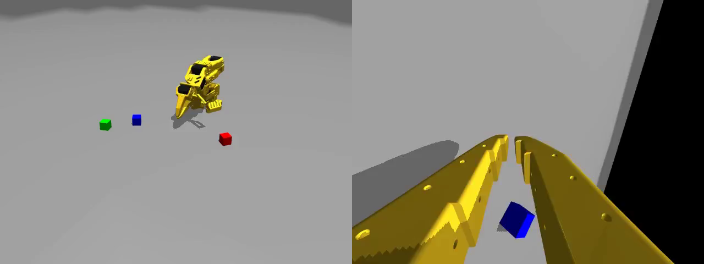<br>三色方块场景与两路相机 | 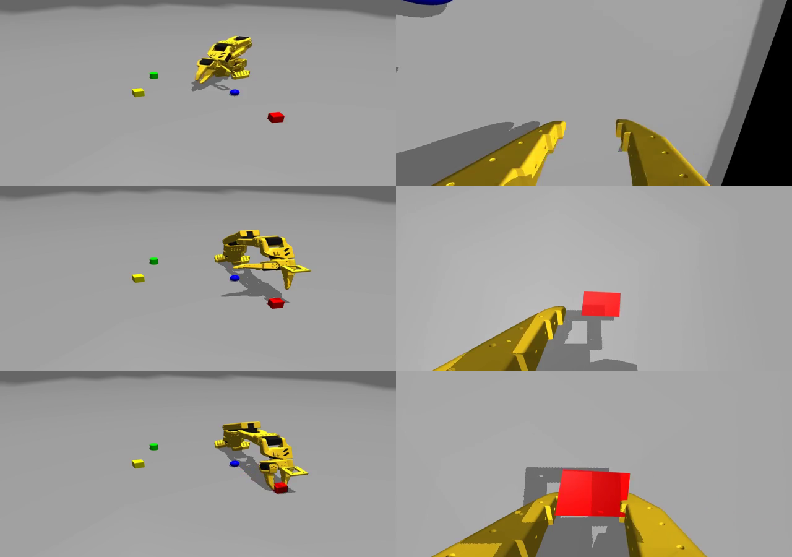<br>脚本专家的三个采集时刻：接近、抓取、抬起 |
| 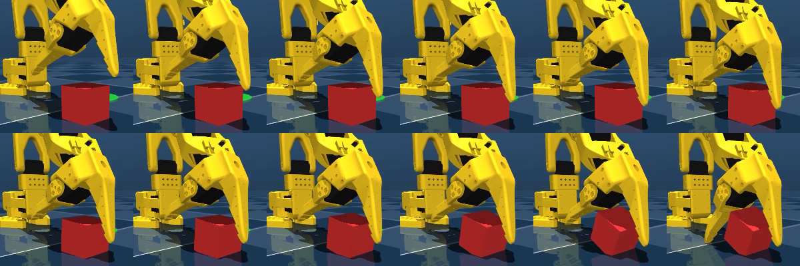<br>夹爪下探接近红色方块（连续 12 帧） | 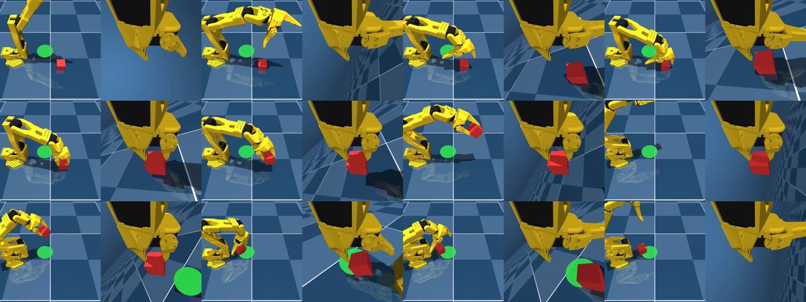<br>三条 episode 各取 6 帧 |

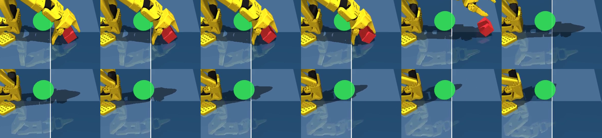

### 训练过程对照

| | |
|---|---|
| 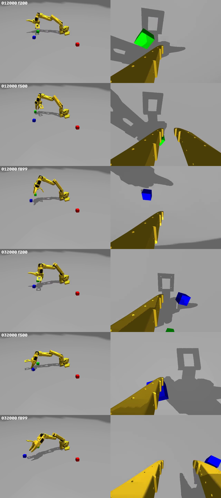<br>012000 与 032000 在 200/500/899 帧的对照 | 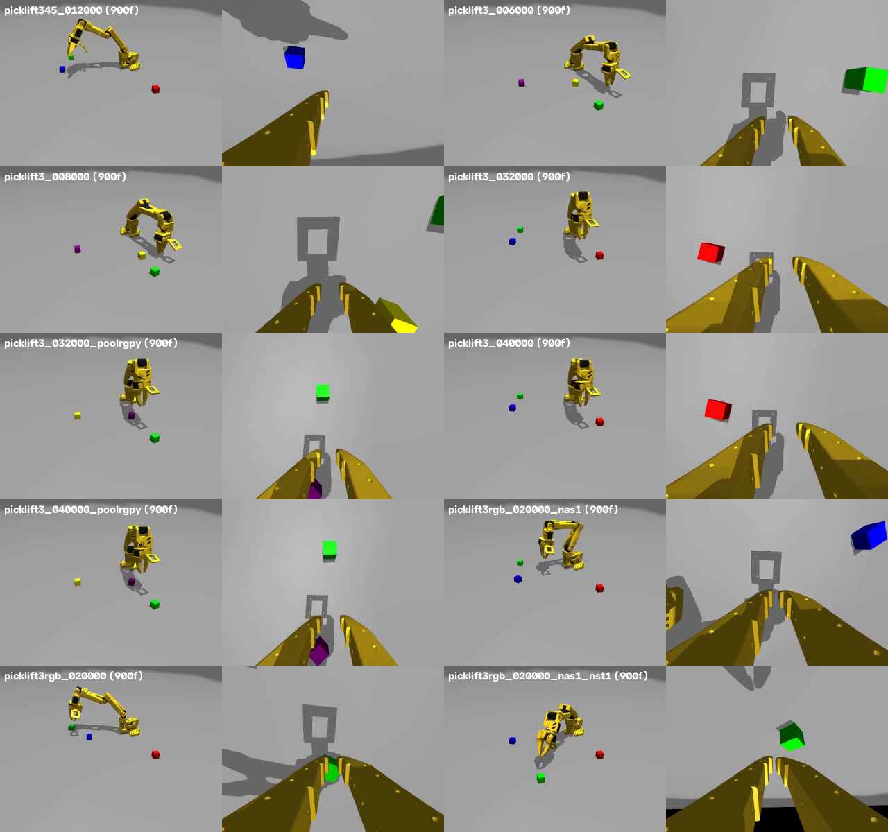<br>多档早期 checkpoint 在 900 帧的末状态 |

### 专家演示

| 预览 | 这一段发生了什么 |
|---|---|
| 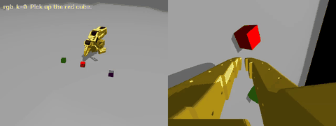 | **专家重抓（rgb）**：指令是 `rgb: pick up the red cube`。先朝方块旁边的空位下扎、合爪抓空，张开后重新对准红色方块抓取并抬起。[完整 mp4](docs/media/expert_retry_rgb.mp4) |
| 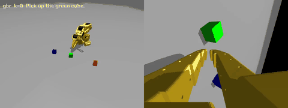 | **同布局换色（gbr）**：与左边同一份物体摆位，配色轮换成 gbr、指令词改成 green；动作序列不变，只是目标换成绿色方块。[完整 mp4](docs/media/expert_retry_gbr.mp4) |

### 策略 rollout

| 预览 | 这一段发生了什么 |
|---|---|
|  | **SmolVLA 闭环成功（green）**：seed 10000、默认色 green。机械臂从悬停位下探，夹住绿色方块并抬离桌面，判成功。[完整 mp4](docs/media/policy_green_success.mp4) |
| 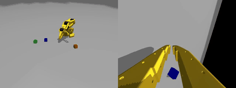 | **SmolVLA 闭环失败（blue）**：同一 checkpoint、指令改 blue。模型夹起的是绿色方块，目标颜色不对，判失败；片段长 30 秒，对应 900 步评测上限。[完整 mp4](docs/media/policy_blue_failure.mp4) |
| 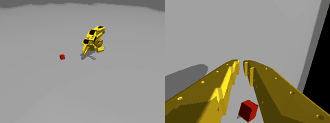 | **PPO 残差基座（red）**：seed 10003、red、零残差基线的对照。悬停、下探、夹住红色方块后抬起，作为 PPO 残差成功率的基线。[完整 mp4](docs/media/base_policy_red_success.mp4) |

## 边界与已知问题

- 本仓库只覆盖仿真；真机链路在 [so101-real-harness](https://github.com/comradejiang/so101-real-harness)。
- 本地单任务线和主链路的状态/动作口径不同，不能直接混训。
- 非默认颜色指令成功率为 82%，颜色泛化仍是主要短板；失败样例在媒体区保留了 blue 的一条。
- PPO 残差直接读 MuJoCo 里的目标方块位姿和 TCP 位姿，这是仿真特权信息；上真机需要额外的视觉估计。
- `teleop_collect.py` 依赖 Windows 的 Win32 输入和 OpenCV 窗口，只在 Windows 下运行。
- 数据集、checkpoint、日志不随仓库发布；运行前按环境修改 `paths.py` 和 `_ref/_launch_*.sh` 中的路径。

## 文档

- `docs/best-从零复现.md`：best checkpoint 的六阶段复现配方、每步超参和产物。
- `docs/自复位长时程采集方案.md`：无人值守长时程采集的 CV 定位、IK、成功判定、漂移对策和已知缺陷。
- `docs/训练数据谱系.md`：全部数据集的条数/帧数、采集方式、训练超参和实验分支。
